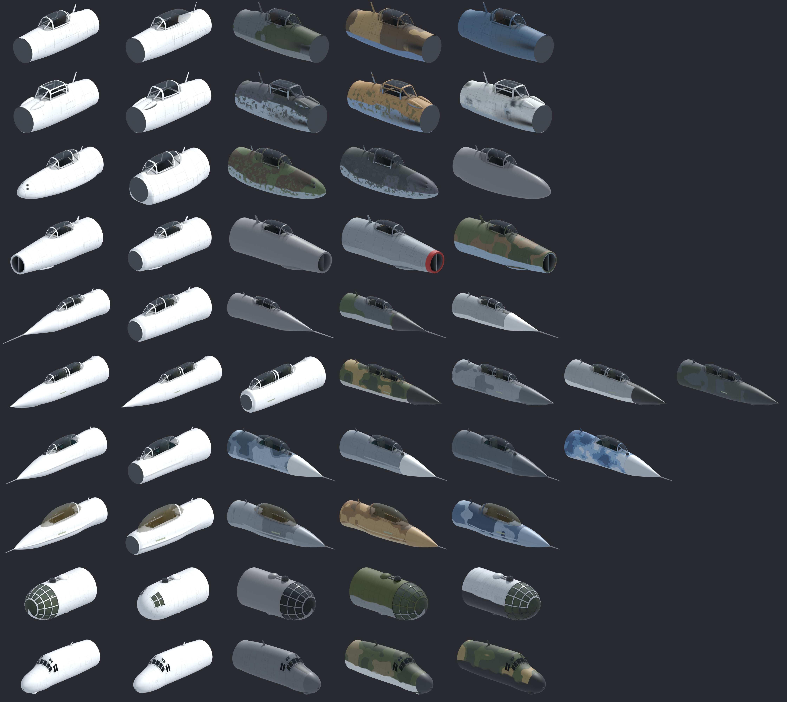

WARNİNG!!!!

This project was made almost entirely by claude and gemini.I am not a coder nor a developer im a man with some ideas.So don't expect anything professional from this mod and if you are not okay with this please don't download nor comment.I made this for my playthrough at first but then realised there may be people that could use it so im uploading these here.

# ROPlanes+ (ROPlanesPlus)

**Historical cockpits, a procedural propeller engine and a launch pylon for Kerbal Space Program 1.12 with RealSolarSystem, Realism Overhaul and RP-1.**

ROPlanes+ adds aircraft parts for the realism stack (RSS / RO / RP-1, FAR, AJE, Kerbalism, RealAntennas):

- **10 historical cockpits** at real size, from the Spitfire to the B-52, each with switchable versions and paint schemes, see-through canopies and a modelled cockpit interior.
- **1 procedural propeller engine** that becomes any propeller powerplant (radial, inline, turboprop, single or contra-rotating, tractor or pusher), with its own Engine Workshop window, live sound and exhaust effects.
- **1 procedural launch pylon** for air-launching aircraft (X-1 style drops from a B-29).



> **Status: early development.** Everything is built and passes the mod's own checks, but several features have not been tested in game yet (marked *untested* below). Bug reports are very welcome in the [Issues](../../issues) tab.

---

## Contents

1. [Requirements](#requirements)
2. [Installation](#installation)
3. [Procedural Propeller Engine](#procedural-propeller-engine)
4. [Historical cockpits](#historical-cockpits)
5. [Procedural Launch Pylon](#procedural-launch-pylon)
6. [Compatibility with other mods](#compatibility-with-other-mods)
7. [Building from source](#building-from-source)
8. [Credits and license](#credits-and-license)

---

## Requirements

**Required**
- Kerbal Space Program **1.12.x**
- [ModuleManager](https://github.com/sarbian/ModuleManager)
- [B9PartSwitch](https://github.com/blowfishpro/B9PartSwitch) (cockpit versions and paint schemes, pylon paint)

**Made for (strongly recommended)**
- RealSolarSystem, Realism Overhaul and RP-1
- Ferram Aerospace Research (FAR)
- Advanced Jet Engine (AJE) with SolverEngines: the propeller engine uses AJE's propeller model. Without AJE a simple stock fallback engine is used.
- Kerbalism and RealAntennas (patches included)

**Optional:** TexturesUnlimited, SimpleRepaint, Reforged Materials, BDArmory (see [Compatibility](#compatibility-with-other-mods)).

---

## Installation

1. Go to [**Releases**](../../releases) and download the latest `ROPlanesPlus-vX.Y.Z.zip` (under *Assets*).
2. Unzip it into your KSP folder (the one that contains `GameData`), so you end up with `Kerbal Space Program/GameData/ROPlanesPlus/`.
3. Make sure ModuleManager and B9PartSwitch are installed.

Only `GameData/ROPlanesPlus` is needed to play. Everything else in this repository is the source the mod is built from (the green **Code → Download ZIP** button gives you all of it, including the latest unreleased changes).

**Upgrading from an older build:** the Spitfire and Bf 109 cockpits now use a 0.9375 m ring (their real fuselage width), and the old separate engine parts (`ROPlanes-ProcProp-Radial`, `-VInline`, `-Turboprop`, `-Contra`) were replaced by one engine part. Craft built with those need the parts re-attached. Propellers now turn clockwise (seen from the cockpit) by default.

---

## Procedural Propeller Engine


**One part, `ROPlanes-ProcProp` ("Procedural Propeller Engine")**, becomes any propeller powerplant. It is available from the start of RP-1 (`unlockParts`); turboprop engines unlock in the Workshop as you research their era.

### Engine Workshop
Right-click the engine and press **Open Engine Workshop** at the very top of the menu (works in the VAB, SPH and in flight). If the craft has several engines, the arrows in the window header switch between them (symmetry twins count as one). Hover over any option to see a short explanation at the bottom of the window.

- **Engines:** every historical engine as a card (type, power, weight, aircraft). Engines from a later RP-1 era show which tech unlocks them. **Build your own engine** keeps the current engine as a starting point.
- **Engine:** type (radial, inline, turboprop), layout (9/14/18/28-cylinder radial, V-12, inverted V-12, X-24; three turboprop sizes), cylinder size and count, boost, supercharger and engine speed.
- **Propeller:** size (with a **Best size** button), blades, single or contra-rotating, blade shape and spinner.
- **Paint:** 14 schemes (bare metal, RAF, Luftwaffe, US Navy, Soviet, USAAF olive drab, desert, IJN black cowl, air racer, airliner, night fighter, trainer yellow, arctic whitewash, Italian smoke rings) plus **Custom Paint** with your own cowling, nose-ring and spinner colours and a matt, satin or gloss finish.
- **Options:** cowling fit (automatic or bigger), nacelle, tractor or pusher, propeller rotation direction (and opposite rotation on the other side of a symmetry pair), propeller strikes, turboprop auto-feather and optional propeller torque.
- **Performance panel:** power, take-off pull, pull at 500 km/h, power at 6 km, weight, power-to-weight, fuel use and cost, each with a plain-words change since you opened the window ("6% stronger takeoff", "12% heavier"). **Last change** explains what your last edit did, **Undo all** restores the engine as it was, and **Listen** plays the engine starting, running up and shutting down.
- **In flight** the window shows live gauges (power, propeller RPM, blade pitch, boost, thrust, WEP time) with WEP / Feather / Reverse buttons, and an engine info page.

### Designs that make sense
- **Power follows the cylinders.** Power comes from cylinder size (1.0–4.2 L per cylinder, the span of real aero engines), boost and engine speed. A 9-cylinder radial without a supercharger tops out under 1,000 hp, a supercharged X-24 near 5,000 hp. Engine speed is limited by piston speed, like real engines.
- **The cowling fits the engine.** Its diameter and length come from cylinder size and row count. In manual mode the cowling can be bigger, never smaller, than the engine inside it, and the propeller is always kept larger than the cowling.
- **Weight is built up** from the dry engine, the supercharger or turbo, the propeller blades and hubs, and the contra gearbox.
- **Switching type keeps the engine's weight.** A turboprop is about 2.5× lighter per horsepower, so a 2,000 hp radial turned into a turboprop gives about 5,000 shp at the same weight.
- **Contra-rotation recovers the slipstream swirl** a single propeller wastes: about +5 % pull on a 2,000 hp fighter and +14 % on an NK-12-class turboprop. It costs weight and money and doesn't add engine power.

### Historical engines

Where AJE ships its own config for an engine, the preset uses those numbers unchanged; the rest are derived from published data with the same conventions. Weights are dry engine plus propeller.

| Engine | Power | Weight | Source | RP-1 tech |
|---|---|---|---|---|
| Rolls-Royce Merlin 66 (V-12) | 1,975 hp | 940 kg | AJE SXT | start |
| Rolls-Royce Griffon 88 (V-12, contra) | 2,320 hp | 1,237 kg | AJE Griffon88 | start |
| Daimler-Benz DB 605A (inverted V-12) | 1,475 hp, WEP 1,770 (MW-50) | 976 kg | AJE DB-605-A | start |
| Junkers Jumo 213E (inverted V-12) | 1,865 hp, WEP +10 % | 1,070 kg | AJE SXT | start |
| Allison V-3420 (X-24, contra) | 2,600 hp | 1,650 kg | derived from AJE V-1710-89 | start |
| Wright R-1820 Cyclone (9-cyl) | 1,200 hp | 780 kg | derived | start |
| P&W R-2800 Double Wasp (18-cyl) | 2,100 hp, WEP 2,380 | 1,381 kg | AJE SXT | start |
| Wright R-3350 Turbo-Compound (18-cyl) | 3,250 hp, WEP 3,500 | 1,890 kg | AJE KAX | start |
| P&W R-4360 Wasp Major (28-cyl) | 3,500 hp, WEP 3,800 | 2,250 kg | derived | start |
| Shvetsov ASh-82FN (14-cyl) | 1,850 hp | 980 kg | AJE M-82 | start |
| AS Double Mamba (contra turboprop) | 2,950 shp | 1,350 kg | derived | `supersonicFlightRP0` |
| Allison T56 | 4,910 shp | 1,350 kg | derived | `matureSupersonic` |
| Kuznetsov NK-12MV (contra turboprop) | 14,795 shp | 4,000 kg | derived | `highSpeedFlight` |
| P&W Canada PT6A | 680 shp | 220 kg | AJE SXT | `highSpeedFlight` |

Costs follow RP-1's AJE engines: pistons ≈ 8 + 0.0085 × hp (contra × 1.2), turboprops ≈ 4 + 0.0267 × shp.

### Realism options
- **Propeller strikes:** a spinning propeller that touches the ground or the sea breaks: the blades bend, the engine stops and can't be restarted. A Kerbal engineer on EVA can fit a new propeller while the craft is on the ground.
- **Auto-feather** (turboprops): if the engine stops in flight, the blades turn edge-on to cut drag and unfeather when the engine restarts.
- **Propeller torque** (off by default): the shaft torque rolls the aircraft, as on real single-engine aircraft. Contra-props have none, and engine pairs can be set to turn opposite ways.
- **Start-up:** piston engines crank, cough and catch (cold engines misfire more); turboprops spool up through light-off to ground idle. Engines switched on together start in step.

### Sound and effects
- The engine sound follows the real AJE propeller RPM and load. Radial, V-12 and turboprop loops are built from **real aircraft recordings** (P-47, PZL-104 Wilga, Bf 109, P-51, a Merlin on a test stand, a PT6 floatplane; see [Credits](#credits-and-license)), mixed with a propeller layer, wind, supercharger whine, starter and cranking sounds, backfires and pops after a throttle chop. Sound is muffled in IVA, fades in thin air and has Doppler for other aircraft.
- Visuals: the propeller spins at the live RPM and fades to a motion-blur disc, blade pitch follows the governor, feathering and reverse, exhaust stubs glow with power, and the plugin draws its own exhaust flames, smoke trails, the start-up smoke cloud, coughs, backfire sparks and prop-strike debris.

### FAR and AJE integration
- AJE's `ModuleEnginesAJEPropeller` is configured through reflection, so AJE is never a hard dependency. WEP uses AJE's `VolETweak` and feathering uses AJE's own `SetFeather`.
- A `FARPartModuleException` keeps FAR from voxelizing the spinning hubs, blades and discs, while the procedural cowling and spinner colliders are voxelized.
- Fuel (AvGas) is drawn evenly from the whole vessel, so wing-mounted engines don't depend on crossfeed through the wing roots.

---

## Historical cockpits

The cockpits are modelled, baked and painted in Blender at **real size**. Every rear ring is a true circle of a standard diameter, so it mates with round tanks and fuselage parts; the propeller-fighter sections have a round front ring for the propeller engine. Pick the **version** and **paint scheme** in the editor. "Open front" versions end in a round ring with a node for your own nose cone or intake.

The canopies and glazed noses are see-through glass with a modelled cockpit inside (tub, seats, instrument panels with painted dials, gunsight or HUD, stick or yokes). Every cockpit starts **Plain White** with no markings, ready for a colour mod; the historical schemes (camouflage, natural metal, the MiG-15's red intake lip, exhaust staining) are in the paint switch. **Toggle Cockpit Lights** lights the instrument dials (and the formation lights on the F-16 and F-4).

| Part | Aircraft | Length | Rings (rear / front) | Versions | Paint schemes (besides Plain White) | Crew | Mass | RP-1 tech | Ceiling |
|---|---|---|---|---|---|---|---|---|---|
| `ROPlanes-Spitfire-Cockpit` | **Supermarine Spitfire** | 3.4 m | 0.9375 m / 0.9375 m | Mk IX (high back); Mk XVI (low back, bubble canopy) | RAF Day Fighter; Desert; Photo Recon Blue | 1 | 0.31 t | `unlockParts` | 14 km |
| `ROPlanes-Bf109-Cockpit` | **Messerschmitt Bf 109** | 3.2 m | 0.9375 m / 0.9375 m | G-6 (framed canopy); G-10 / K-4 (Erla clear-view hood) | RLM 74/75/76 Grey; RLM 79/78 Tropical; Winter Whitewash | 1 | 0.29 t | `unlockParts` | 14 km |
| `ROPlanes-Me262-Cockpit` | **Messerschmitt Me 262** | 3.1–4.7 m | 1.25 m | A-1a cannon nose; Open front (0.9375 m) | RLM 81/82 over 76; RLM 74/75 over 76; Bare Metal | 1 | 0.38 t | `unlockParts` | 15 km |
| `ROPlanes-B29-Cockpit` | **Boeing B-29 Superfortress** | 6.4 m | 3 m | Glazed nose; Solid nose | Natural Metal; Olive Drab / Neutral Grey; Korean War Night Black | 4 | 2.10 t | `unlockParts` | 16 km |
| `ROPlanes-MiG15-Cockpit` | **MiG-15bis** | 4.3–4.8 m | 1.5 m | Nose intake; Open front (0.9375 m) | Natural Metal; Air Superiority Grey; Warsaw Pact Camouflage | 1 | 0.44 t | `supersonicFlightRP0` | 20 km |
| `ROPlanes-F104-Cockpit` | **Lockheed F-104G Starfighter** | 4.3–6.6 m | 1.5 m | Radome and pitot boom; Open front (0.9375 m) | Natural Metal; NATO Green/Grey; Gull Grey | 1 | 0.55 t | `matureSupersonic` | 37 km |
| `ROPlanes-F4-Cockpit` | **McDonnell Douglas F-4 Phantom II** | 5.7–9.2 m | 1.875 m | F-4E gun nose; F-4J radar nose; Open front (0.9375 m) | Southeast Asia; Hill Grey II; Navy Gull Grey / White; European One | 2 | 1.05 t | `highSpeedFlight` | 38 km |
| `ROPlanes-Su27-Cockpit` | **Sukhoi Su-27S Flanker** | 5.3–7.8 m | 1.875 m | Radome and pitot; Open front (1.25 m) | Flanker Blue-Grey; Navy Grey; Modern Dark Grey; Ukrainian Digital | 1 | 0.90 t | `refinedTurbofans` | 38 km |
| `ROPlanes-F16-Cockpit` | **General Dynamics F-16C** | 5.0–7.0 m | 1.5 m | Radome and pitot; Open front (0.9375 m) | Two-Tone Grey; Aggressor Desert; Aggressor Blue | 1 | 0.62 t | `matureTurbofans` | 37 km |
| `ROPlanes-B52-Cockpit` | **Boeing B-52 Stratofortress** | 10.5 m | 3 m | B-52H (EVS blisters); B-52D (smooth chin) | Gunship Grey; SIOP Camouflage; Southeast Asia | 4 | 3.60 t | `matureSupersonic` | 20 km |

Lengths exclude pitot booms. Radome versions add the mass of their radar. With RO / Kerbalism / RealAntennas installed the cockpits get life support, habitation, an antenna and realistic heat limits.

---

## Procedural Launch Pylon


**`ROPlanes-ProcPylon` ("Procedural Launch Pylon")** is a drop pylon for air launches. Unlike a stock radial decoupler, which stays attached to the launched aircraft, the pylon **stays on the carrier** and releases whatever hangs from its hook face.

- **How to use:** attach the pylon under the carrier (wing or fuselage), then attach the aircraft to be dropped to the pylon's bottom (hook) face. Staging or the part menu releases it, with an adjustable ejection force.
- **Shape (editor part menu, "Launch Pylon Shape"):** length, height, width, bottom length and width, sweep, profile (aerofoil, rounded or box) and optional hooks and sway braces. Mass and cost follow the size.
- **Paint:** Natural Metal, Gloss White, Light Grey, Gloss Black, Test Orange.
- Available from the start of RP-1 (`unlockParts`). Crossfeed is off by default.
- *Untested in game.* Known gap: the propeller engines' fuel draw ignores crossfeed, so a carrier's engines can also drain AvGas from a hanging aircraft until it is released.

---

## Compatibility with other mods

- **TexturesUnlimited** (and TU packs such as TURD, Recolour Collection, Lazy Painter): the cockpits default to **Plain White (recolourable)**; press **Open Recoloring GUI** in the part menu to paint the upper surfaces, lower surfaces and details (canopy frames, anti-glare panel, radome, intake lip). The historical schemes and their period colours are included. *Untested in game.*
- **SimpleRepaint:** tints the cockpit skin only, not the glass or interior. With TexturesUnlimited also installed, use TU's window instead. *Untested in game.*
- **Reforged Materials:** works without a patch.
- **ConformalDecals** and **TextureReplacer:** no patch needed.
- **BDArmory:** cockpits get hit points and armour. *Untested in game.*
- All patches are written so they only run when the other mod is installed, and never make ModuleManager think a missing mod is present.

---

## Building from source

Almost everything in `GameData/ROPlanesPlus` is generated by the scripts in this repository, so change the scripts and rebuild rather than editing the generated files. Run everything from the repository folder in PowerShell:

```powershell
python generate_cockpits.py              # cockpit models, paint schemes, maps and icons (needs Blender)
python generate_propeller_assets.py      # propeller engine model, liveries, paint kit and icon
python generate_pylon_assets.py          # launch pylon model, textures and icon
python generate_sounds.py                # engine sounds (28 files)
python generate_configs.py               # all part .cfg files and compatibility patches
powershell -ExecutionPolicy Bypass -File build_plugin.ps1   # compile ROPlanesPlus.dll
python verify_mu_and_configs.py          # check all models, configs, textures, sounds and the DLL
```

- Python scripts use only the standard library, except `process_recordings.py` (the recorded engine loops), which needs `numpy`, `scipy` and `ffmpeg`. Without them the synthesized sounds are used.
- The cockpits need **Blender** (5.x; set `$env:BLENDER` if it isn't found automatically).
- `build_plugin.ps1` compiles with the .NET Framework `csc.exe` against KSP's managed DLLs; pass `-KspManagedDir "<KSP>\KSP_x64_Data\Managed"` if KSP isn't at the default Steam path.
- The raw sound recordings are not in this repository (they are large); `sound_sources/README.md` explains how to download them from Freesound.
- `CLAUDE.md` contains detailed developer notes on the whole pipeline and plugin.

| Folder / file | What it is |
|---|---|
| `GameData/ROPlanesPlus/` | The finished mod (what players install) |
| `Source/ROPlanesPlus/` | C# source of the plugin (`ROPlanesPlus.dll`) |
| `blender/` | Blender script that builds the cockpits |
| `cockpit_specs.py` | Shape, interior and paint data of every cockpit |
| `generate_*.py`, `process_recordings.py` | Asset, sound and config generators |
| `verify_mu_and_configs.py` | Checks the finished mod |

---

## Credits and license

**ROPlanes+** © 2026 Fake_kerman, licensed under the [GNU General Public License v3.0](https://www.gnu.org/licenses/gpl-3.0.html): you may use, share and modify it, but anything you distribute that is based on it must also be released under GPL v3 with its source. See [LICENSE](LICENSE). The engine sound recordings below are not covered by the GPL; they keep their own licences.

**Contributors:** Fake_kerman (ideas, design decisions and testing); built almost entirely by the AI assistants **Claude** (Anthropic) and **Gemini** (Google).

**Engine sounds:** the recorded loops are made from Freesound recordings and keep their original licences (CC BY 3.0, CC BY 4.0 and CC0). Thanks to jarekgie (PZL-104 Wilga), Fight2FlyPhoto (P-47, Bf 109, P-51), squashy555 (Merlin), craigsmith (glider airflow) and jerry.berumen (PT6 floatplane). Full details and links are in [`GameData/ROPlanesPlus/Sounds/CREDITS.txt`](GameData/ROPlanesPlus/Sounds/CREDITS.txt).

**Engine data:** engine numbers marked "AJE" above are taken from the configs of [Advanced Jet Engine](https://github.com/KSP-RO/AJE).

Built for the [KSP-RO](https://github.com/KSP-RO) community's RealismOverhaul and RP-1.
